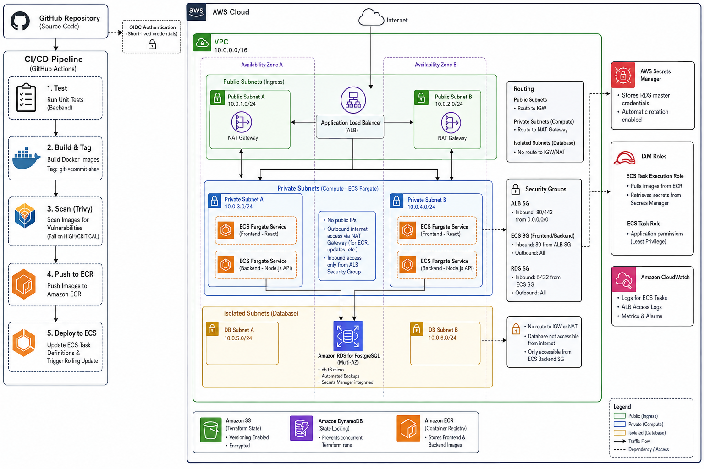

# Octa Byte DevOps & Cloud Infrastructure Architecture



This repository contains the declarative Infrastructure as Code (IaC) and continuous deployment pipeline for hosting the Octa Byte Transaction Service. The main aim of the project is to demonstrate a production-style, secure and automated DevOps setup on Amazon Web Services (AWS).

---

## 1. Executive Summary

The project shows the move from local development to a cloud environment, with an emphasis on infrastructure operations, security and deployment automation.

Key engineering points:

- **Infrastructure as Code:** All application infrastructure is defined in Terraform, with no manual console provisioning. (The one manual step is the bootstrap identity that Terraform itself runs as.)
- **Serverless containers:** The workload runs on AWS ECS Fargate, so there are no servers to patch or capacity to manage.
- **Defence-in-depth networking:** A three-tier VPC with isolated database subnets, and security groups that reference each other instead of IP ranges.
- **Managed secrets:** No database password exists in code, variables or the Terraform state. AWS generates and manages it in Secrets Manager.
- **Automated delivery:** A GitHub Actions pipeline with OIDC authentication (no stored AWS keys), dependency and image vulnerability scanning, a manual production approval gate, and rolling ECS deployments.

---

## 2. The Application Context (Short version)

While the focus of this repository is operations, it hosts a decoupled three-tier application:

- **Frontend:** A static single-page application built with React and served by Nginx.
- **Backend:** A REST API built with Node.js and Express. It applies the database schema automatically when it starts.
- **Database:** A PostgreSQL relational database.
- **Routing:** The Application Load Balancer does all request routing. There is no reverse proxy inside the application containers.

---

## 3. Cloud Infrastructure Setup (AWS)

The infrastructure is designed for simplicity and low operational overhead, with a few deliberate cost trade-offs listed in section 3.5.

### 3.1 Serverless Compute (ECS Fargate)

The application workload is hosted on Amazon Elastic Container Service (ECS) using the Fargate launch type.

- **Zero-Ops compute:** Fargate hides the underlying EC2 instances, removing OS patching, AMI management and cluster capacity scaling.
- **Task definitions:** Each service's CPU, memory, environment variables, secrets and CloudWatch log configuration are declared in Terraform. CPU and memory are variables (`variables.tf`).

### 3.2 Relational Database Service (RDS)

The data tier uses Amazon RDS for PostgreSQL 15.

- RDS handles automated backups, minor-version patching and storage management. Storage is encrypted.
- **Burstable performance:** The instance class is `db.t3.micro`, a cost-effective fit for a small transactional workload.
- The instance is **single-AZ** (`multi_az` is off) to save cost. See section 3.5.

### 3.3 Networking Topology (VPC Design)

The environment is a custom Virtual Private Cloud (VPC) across two Availability Zones, with a three-tier subnet structure. Subnet CIDRs are derived from the VPC range with Terraform's `cidrsubnet()` rather than typed by hand.

1. **Public subnets:** Contain only the Application Load Balancer (ALB) and the NAT Gateway, and have a route to the Internet Gateway.
2. **Private compute subnets:** Contain the ECS Fargate tasks. Outbound traffic (for example pulling ECR images) goes through the NAT Gateway, and there is no direct public ingress.
3. **Isolated database subnets:** Contain the RDS instance and have no route to the Internet Gateway or the NAT Gateway, so the database is unreachable from the internet.

### 3.4 Consolidated Load Balancing

A single Application Load Balancer handles all incoming traffic, which keeps one public hostname and avoids CORS between the frontend and API.

- **Path-based routing:** Requests matching `/api/*` go to the backend target group. Everything else goes to the frontend target group. The ALB forwards the path unchanged, so the Express routes themselves start with `/api`.
- **Health checks:** The ALB polls `/health` on the backend and `/` on the frontend, and stops sending traffic to unhealthy tasks.

### 3.5 Known Limitations (deliberate trade-offs)

- **HTTP only:** The ALB listens on port 80. Adding HTTPS means an ACM certificate, a port 443 listener and an HTTP-to-HTTPS redirect.
- **Single-AZ database, single task per service, single NAT Gateway:** Two AZs are used for the subnets and the ALB, but the database instance, the NAT Gateway and (by default) each ECS service's single task run in one place to save cost. A true multi-AZ setup is `multi_az = true`, a higher `desired_count`, and one NAT Gateway per AZ.
- **Writable container root filesystem:** See section 4.3.
- **Report-only image scanning:** See section 6.2.
- **Unpinned scanner action:** The pipeline uses `trivy-action@master` rather than a pinned version.

---

## 4. Security and Compliance Position

Security is built in using a defence-in-depth approach.

### 4.1 Managed Secrets

Hard-coded database credentials are a serious vulnerability.

- **Creation and rotation:** Terraform sets `manage_master_user_password`, which tells RDS to generate the password and store it in AWS Secrets Manager, where AWS manages it.
- **Injection at start-up:** The backend's ECS Task Execution Role is granted permission to read that one secret. When the container starts, the ECS agent injects the value as the `DB_PASSWORD` environment variable.

### 4.2 Security Groups (least privilege, chained by reference)

Network traffic is restricted at the Elastic Network Interface (ENI) level, and rules reference other security groups instead of IP ranges:

- **ALB security group:** Allows inbound HTTP (port 80) from `0.0.0.0/0`. (HTTPS is a known gap, see 3.5.)
- **Frontend and backend ECS security groups (one each):** Each allows inbound traffic only from the ALB security group, and only on its own port (80 for the frontend, 4000 for the backend).
- **RDS security group:** Allows inbound TCP 5432 only from the **backend** ECS security group, so the frontend tasks have no network path to the database.

### 4.3 Container Hardening and IAM Roles

- **Root filesystem (known trade-off):** The container definitions set `readonlyRootFilesystem = false`. The ECS module defaults to read-only, but Nginx writes its cache and PID files at start-up and crashed with the default. The hardening path is to restore read-only and add `tmpfs` mounts for only those directories (Fargate supports `tmpfs` through `linuxParameters` since January 2026). This has not been implemented yet.
- **Role separation:** The **Task Execution Role** is used by the ECS agent to pull images and fetch secrets. The **Task Role** is what the application would use at runtime to call AWS APIs, so application code has no access to the deployment secrets.
- **Pipeline role:** GitHub Actions assumes a dedicated role whose permissions are limited to pushing to the two ECR repositories, updating the two ECS services, registering task definitions, and passing the ECS task roles.

---

## 5. Infrastructure as Code (Terraform)

The infrastructure is defined in Terraform, which keeps environments reproducible and auditable.

- **Composition:** `terraform/environments/prod` builds the environment from vetted community modules (`terraform-aws-modules`: vpc, alb, ecs, rds, security-group) plus a few direct resources (ECR repositories, the GitHub OIDC provider and role, CloudWatch alarms and dashboards).
- **Variables:** Environment-specific values (region, names, CIDR, instance class, task sizing, engine version) are inputs in `variables.tf`. A staging environment would be a second directory with its own state key and values; none exists yet.
- **Remote state:** The state file is kept in an encrypted, versioned S3 bucket with public access blocked.
- **State locking:** Locking uses the S3 backend's native `use_lockfile = true`, which needs Terraform 1.10 or newer. This removes the legacy DynamoDB lock table.
- **Pinned versions:** Terraform and provider versions are constrained in `versions.tf`.

---

## 6. Continuous Integration and Deployment (CI/CD)

The application delivery pipeline is GitHub Actions (`.github/workflows/deploy.yml`). It builds and deploys container images; it does not run Terraform. Infrastructure changes are applied by an operator.

### 6.1 OIDC Authentication

The pipeline authenticates to AWS with OpenID Connect. Storing long-lived AWS access keys as GitHub secrets is an anti-pattern, so GitHub instead issues a short-lived signed token that AWS exchanges for temporary credentials, which limits the damage if the CI system is compromised.

### 6.2 Pipeline Execution Flow

1. **Test phase:** The backend unit tests and a dependency audit (`npm audit`, high severity) run on every pull request and push.
2. **Build and tag:** Docker images for the frontend and backend are built and tagged with the Git commit SHA, so each deployment is immutable and traceable to a commit.
3. **Vulnerability scanning (Trivy):** Trivy scans both images, including OS packages, for HIGH and CRITICAL CVEs. It is currently **report-only** (`exit-code: 0`): findings are shown but do not block the build. Enforcing a failure on CRITICAL findings, with a documented exception process, is the planned next step.
4. **Push:** Images are pushed to Amazon Elastic Container Registry (ECR).
5. **Manual approval:** The deploy job targets the GitHub `production` environment, which can require a reviewer to approve.
6. **Deploy:** The live ECS task definitions are downloaded, the new ECR image URIs are injected, and the new revisions are registered.
7. **Rolling update:** ECS starts the new tasks, waits for them to pass the ALB health checks, and then drains the old ones.

---

## 7. Deployment and Local Development

### Prerequisites

- AWS CLI configured with credentials that are allowed to create the resources
- Terraform >= 1.11.0 (required for `use_lockfile`)

### Provisioning the Infrastructure

1. Go to the production directory: `cd terraform/environments/prod`
2. Initialise Terraform (downloads providers and configures the remote S3 backend): `terraform init`
3. Review the execution plan: `terraform plan`
4. Create the infrastructure: `terraform apply`

When it finishes, Terraform prints `alb_dns_name`, the URL of the live site. The first pipeline run then replaces the placeholder container images with the real ones.

### Running Locally

You need Node.js and a PostgreSQL database. Any Postgres works; for example:

```bash
# 1. PostgreSQL
docker run -d --name octa-pg -e POSTGRES_USER=dbadmin -e POSTGRES_PASSWORD=localpw \
  -e POSTGRES_DB=octadb -p 5432:5432 postgres:15-alpine

# 2. Backend on http://localhost:4000 (creates the table on start-up)
cd backend && npm ci
export DB_HOST=localhost DB_USER=dbadmin DB_PASSWORD=localpw DB_NAME=octadb DB_SSL=false
npm start

# 3. Frontend on http://localhost:5173 (the Vite dev server forwards /api/* to the backend)
cd frontend && npm ci && npm run dev
```

`DB_SSL=false` is for local development only. The backend uses SSL by default because AWS RDS requires it. Run the backend tests with `cd backend && npm test`.
